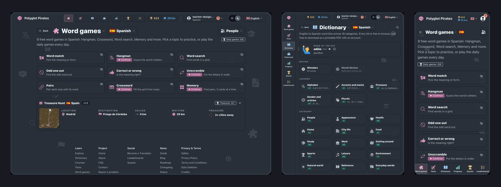

# Navigation: Sidebar, Tab Bar and Colors

The navbar now has three forms, set with one `navigation.layout` key:

- **Bar**: the links across the top. It measures what fits, then drops to icons, then to a menu.
- **Sidebar**: the links down the side from tablet width. Labels on wide screens, a rail of icons below that.
- **Tab bar**: on a phone, the same links along the bottom.

`"auto"` uses the bar where it fits and the sidebar where it does not.



Links have colored icons (`"tone"`), and page titles show their section's icon.

```json
"navigation": {
  "layout": "sidebar",
  "primary_links": [
    {"label": "Word games", "href": "/games", "icon": "hero-puzzle-piece-solid", "tone": "games"}
  ]
}
```

- [Theme guide](https://gamend.org/docs/theme)
- [Github](https://github.com/appsinacup/gamend)

## Examples

- [Polyglot Pirates](https://polyglotpirates.com)
- [Forge](https://balaurengine.org)
